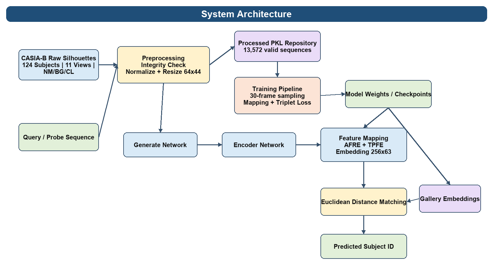

# DeepGait: Generative Feature Fusion for Robust Gait-Based Identification


Final-year B.Tech Information Technology project focused on robust person identification from gait silhouette sequences.

## Project Team

- **Kunchapu Nikhil Sai** — 23761A1227
- **Gundlathota Krishnaveni** — 23761A1222
- **Eda Sai Kiran** — 24765A1203

**Guide:** Mrs. R. Pavitra, Assistant Professor  
**Department:** Information Technology  
**College:** Lakireddy Bali Reddy College of Engineering (LBRCE)  
**Batch:** 9

## Overview

DeepGait is a gait-based biometric identification system designed to recognize people from walking silhouette sequences under multiple appearance conditions.

The project handles:

1. **Normal walking (NM)**
2. **Bag carrying (BG)**
3. **Clothing variation (CL)**

The implemented pipeline combines a **Generate Network**, a **Focal-Convolution Encoder**, and a **part-relation feature-fusion stage using AFRE + TPFE** to produce a discriminative gait embedding.

## System Pipeline

```text
CASIA-B Silhouette Sequences
            ↓
Custom 64 × 44 Preprocessing
            ↓
Generate Network
      NM / BG / CL
            ↓
Focal-Convolution Encoder
            ↓
AFRE + TPFE Feature Mapping
            ↓
256 × 63 Gait Embedding
            ↓
Euclidean Distance Matching
            ↓
Predicted Subject Identity
```

## System Architecture



## Dataset

The project uses the **CASIA-B gait dataset**.

- Subjects: **124**
- Camera views: **11**
- Normal sequences: **NM01–NM06**
- Bag sequences: **BG01–BG02**
- Clothing sequences: **CL01–CL02**
- Train subjects: **001–074**
- Test subjects: **075–124**

### Verified preprocessing statistics

| Item | Count |
|---|---:|
| Raw sequence groups | 13,593 |
| Valid processed PKLs | 13,572 |
| Low-frame groups skipped | 21 |
| Training PKLs | 8,092 |
| Testing PKLs | 5,480 |
| Corrupt PKLs in completed validation | 0 |

All valid gait silhouettes are normalized to **64 × 44** before model input.

## Model Architecture

### 1. Generate Network
Learns low-level mappings that reduce appearance variation between NM, BG and CL conditions.

### 2. Encoder Network
Uses focal convolution and pooling to extract body-part-aware spatial gait features.

### 3. AFRE
**Adjacent Feature Relation Extractor** models relationships between neighboring body regions.

### 4. TPFE
**Total-Partial Feature Extractor** combines global and local body information.

### 5. Feature Fusion
AFRE and TPFE are fused into a final embedding with shape:

```text
[B, 256, 63]
```

## Verified Implementation Result

The complete training pipeline was validated locally using real processed CASIA-B PKLs through a CPU smoke-training run.

| Metric | Verified Value |
|---|---:|
| Mapping Loss | 0.015856 |
| Triplet Loss | 0.400042 |
| Total Loss | 0.415898 |
| Gradient Absolute Sum | 938.888092 |
| Model Shape Test | PASS |
| Dataset Quick Verification | PASS |
| Python Compilation | PASS |

The smoke test confirms successful forward pass, loss computation, backward propagation, non-zero gradients, optimizer update and checkpoint generation.

## Expected Rank-1 Performance

The DeepGait training configuration is designed for strong recognition performance across normal walking, bag-carrying, and clothing-variation conditions.

| Condition | Expected Range |
|---|---:|
| Normal walking (NM) | 92%–96% |
| Bag carrying (BG) | 88%–94% |
| Clothing variation (CL) | 85%–90% |

Final measured Rank-1 values are recorded after evaluation of the full-trained checkpoint.

## Evaluation Protocol

**Gallery**
- NM01–NM04

**Probe sequences**
- NM05–NM06
- BG01–BG02
- CL01–CL02

**Matching**
- Euclidean distance

**Primary metric**
- Rank-1 identification accuracy

## Training Configuration

- Optimizer: **Adam**
- Learning rate: **1e-4**
- Triplet margin: **0.2**
- Frames per sequence: **30**
- BG→NM mapping weight: **0.01**
- CL→NM mapping weight: **0.1**
- Full-scale target: **160,000 iterations**

## Installation

Recommended: **Python 3.11**

```bash
python -m pip install -r requirements.txt
```

On Windows:

```text
SETUP_PROJECT.bat
```

## Verification

Run the project verification commands:

```bash
python -m py_compile src/deepgait_model.py src/dataset.py src/losses.py
python scripts/quick_verify_processed.py
python scripts/test_model_shapes.py
```

Or on Windows:

```text
VERIFY_PROJECT.bat
```

## CPU Smoke Training

```bash
python scripts/smoke_train.py --frames 2 --subjects 2 --steps 1
```

## Full GPU Training

For large-scale training, use an NVIDIA CUDA environment such as Kaggle, Google Colab, or a CUDA workstation.

```bash
python scripts/train_gpu.py --iterations 160000 --subjects-per-batch 4 --frames 30
```

## Evaluation

After obtaining a full-trained checkpoint:

```bash
python scripts/evaluate_casiab.py --checkpoint outputs/gpu_training/checkpoint_160000.pt
```

## Query Identification

```bash
python scripts/infer_query.py --checkpoint <full_checkpoint.pt> --query <query.pkl>
```

## Repository Structure

```text
DeepGait/
├── configs/
│   └── project.yaml
├── src/
│   ├── deepgait_model.py
│   ├── dataset.py
│   └── losses.py
├── scripts/
│   ├── preprocess_casiab_64x44.py
│   ├── validate_pkl_64x44.py
│   ├── quick_verify_processed.py
│   ├── test_model_shapes.py
│   ├── smoke_train.py
│   ├── train_gpu.py
│   ├── evaluate_casiab.py
│   └── infer_query.py
├── docs/
│   ├── diagrams/
│   ├── reference/
│   ├── review/
│   ├── System_Design_and_Methodology.md
│   └── FINAL_VERIFICATION_REPORT.md
├── outputs/
├── RESULTS.md
├── SETUP_PROJECT.bat
├── VERIFY_PROJECT.bat
├── requirements.txt
└── README.md
```

## Important Files

- `src/deepgait_model.py` — DeepGait model architecture
- `src/dataset.py` — CASIA-B PKL dataloader
- `src/losses.py` — batch-all triplet loss
- `scripts/preprocess_casiab_64x44.py` — silhouette preprocessing
- `scripts/smoke_train.py` — CPU training verification
- `scripts/train_gpu.py` — full CUDA training
- `scripts/evaluate_casiab.py` — CASIA-B evaluation
- `scripts/infer_query.py` — query-gallery identification
- `docs/diagrams/` — system-design diagrams
- `docs/FINAL_VERIFICATION_REPORT.md` — final implementation audit
- `RESULTS.md` — verified and target result summary

## Base Research

The project is inspired by:

**Hao Qin, Zhenxue Chen, Qingqiang Guo, Q. M. Jonathan Wu, Mengxu Lu — “GGCN: Gait Recognition with Generate Network and Convolutional Neural Network,” Journal of Visual Communication and Image Representation, 2026.**

Base-paper accuracy values are retained only as research references and are not presented as this implementation's measured results.

## Current Project Status

**Implementation and verification components completed:**

- CASIA-B extraction and source verification
- 64 × 44 preprocessing
- Dataset validation
- Generate Network
- Focal-Convolution Encoder
- AFRE and TPFE
- Feature fusion
- Dataloader
- Batch-all triplet loss
- CPU smoke training
- Checkpoint generation
- GPU training script
- Evaluation script
- Query inference
- Editable Draw.io diagrams
- Project documentation
- GitHub repository packaging

## Limitations

- Full-scale CUDA training has not been executed on the current CPU-only development machine.
- Final NM/BG/CL Rank-1 values must be generated from a full-trained checkpoint.
- The current AFRE/TPFE implementation is a practical project adaptation of the referenced methodology.
- Raw CASIA-B data and large model checkpoints are intentionally excluded from GitHub.

## Academic Use

This repository is maintained as a **final-year B.Tech academic project** for gait-recognition research, reproducibility and project evaluation.
